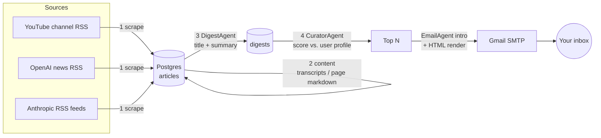

# AI News Aggregator

Every day: scrape AI news from YouTube channels and the OpenAI / Anthropic blogs, summarise each
item with an LLM, rank everything against **your** profile, and email you the top 10.



## How it works

| Step | Code | What it does |
|---|---|---|
| 1. scrape | `app/scrapers/` | Every source is an RSS feed. `RSSScraper` fetches, parses and keeps items inside the lookback window. New items go into `articles`; known ones are skipped. YouTube Shorts are skipped. |
| 2. content | `fetch_content()` per scraper | YouTube → transcript (`youtube-transcript-api`). Anthropic → page converted to markdown. OpenAI blocks scraping (Cloudflare), so the RSS description is used. Items with no content are marked `unavailable` so they're never retried in a loop. |
| 3. digest | `app/agent/digest_agent.py` | LLM writes a headline + 2–3 sentence summary per article (structured output via Pydantic). |
| 4. email | `curator_agent.py`, `email_agent.py`, `services/email.py` | Curator scores every unsent digest 0–10 against `app/profiles/user_profile.py`; the top N get an LLM-written intro, are rendered to HTML, emailed, and marked `sent_at` so you never get the same story twice. |

Every step only processes rows the previous step left behind, so if a run crashes you just run it again.

```
app/
  config.py              all settings (env vars / .env)
  pipeline.py            the 4 steps
  scrapers/              base.py (RSSScraper) + youtube.py + blogs.py; registry in __init__.py
  database/              models.py, connection.py, repository.py (all queries)
  agent/                 base.py (provider presets: OpenAI, Gemini, Groq, OpenRouter, Ollama) + 3 agents
  profiles/user_profile.py   who the digest is for - edit this!
  services/email.py      HTML rendering + Gmail SMTP
docker/docker-compose.yml   local Postgres
.github/workflows/          free daily run on GitHub Actions
Dockerfile, render.yaml     deployment to Render (paid alternative)
main.py                     CLI entry point
```

## Run locally

```bash
uv sync
cp .env.example .env          # fill in LLM_PROVIDER + LLM_API_KEY, MY_EMAIL, APP_PASSWORD
docker compose -f docker/docker-compose.yml up -d   # local Postgres 17
uv run main.py --check        # test DB connection
uv run main.py --dry-run      # full run, email saved to output/ instead of sent
uv run main.py                # full run + send the email
```

Useful flags: `--hours 72` (wider window), `--top 5`, `--steps scrape content` (run some steps only).

**No Docker?** Set `DATABASE_URL=sqlite:///news.db` in `.env`.
### Choosing an LLM API
The agents use the OpenAI SDK, so any OpenAI-compatible API works. Set `LLM_PROVIDER` and `LLM_API_KEY`
(`LLM_MODEL` is optional):

| `LLM_PROVIDER` | Get a key | Default model | Cost |
|---|---|---|---|
| `gemini` | [aistudio.google.com/apikey](https://aistudio.google.com/apikey) | `gemini-2.5-flash` | free tier |
| `groq` | [console.groq.com/keys](https://console.groq.com/keys) | `openai/gpt-oss-20b` | free tier |
| `openrouter` | [openrouter.ai/settings/keys](https://openrouter.ai/settings/keys) | `openai/gpt-4.1-mini` | pay per use, many models |
| `openai` | [platform.openai.com/api-keys](https://platform.openai.com/api-keys) | `gpt-4.1-mini` | pay per use |
| `ollama` | none, runs locally | `llama3.2` | free (small models rank less reliably) |
| `custom` | your server | set `LLM_MODEL` + `LLM_BASE_URL` | - |

If a provider or model doesn't support JSON-schema structured output, the agents automatically retry in plain JSON mode.

### Gmail app password
Needs a personal Gmail with 2-step verification on. Create one at <https://myaccount.google.com/apppasswords>,
put it in `APP_PASSWORD`, and your address in `MY_EMAIL` (it sends to yourself unless `EMAIL_TO` is set).

### YouTube transcript IP blocks
YouTube rate-limits transcript requests, especially from cloud IPs like Render's. If transcripts start coming
back `unavailable`, buy a **Rotating Residential** plan on [Webshare](https://www.webshare.io/) (not "Proxy Server"
/ datacenter) and set `WEBSHARE_USERNAME` and `WEBSHARE_PASSWORD` — the scraper switches to the proxy automatically.

## Customise

- **Your interests:** `app/profiles/user_profile.py`
- **YouTube channels:** `YOUTUBE_CHANNELS` in `app/scrapers/__init__.py` (find a channel id via page source → `"externalId"`)
- **A new RSS source:** subclass `RSSScraper`, add it to `build_scrapers()` — no database change needed:

```python
class HuggingFaceScraper(RSSScraper):
    name = "huggingface"
    def __init__(self):
        super().__init__(["https://huggingface.co/blog/feed.xml"])
    def fetch_content(self, url, guid):
        return url_to_markdown(url)      # optional: full text for better summaries
```

- **Email look:** `render_html()` in `app/services/email.py`
- **Prompts:** the `instructions` in each agent file

## Deploy for free: GitHub Actions + Neon Postgres

`.github/workflows/daily-digest.yml` runs the pipeline every day at 01:30 UTC (07:00 IST).
GitHub Actions minutes are free for public repos, and Neon's free Postgres doesn't expire.

1. **Database:** create a free project at [neon.tech](https://neon.tech) → copy the connection string
   (`postgresql://…neon.tech/neondb?sslmode=require…`).
2. **Secrets:** repo → **Settings → Secrets and variables → Actions → New repository secret**, or from a terminal
   (`gh secret set` prompts for the value, so it never lands in your shell history):

   ```bash
   gh secret set DATABASE_URL     # Neon connection string
   gh secret set LLM_API_KEY      # e.g. Gemini key
   gh secret set MY_EMAIL         # your Gmail address
   gh secret set APP_PASSWORD     # Gmail app password
   ```

   Optional: `EMAIL_TO`, `WEBSHARE_USERNAME`, `WEBSHARE_PASSWORD`. To use another provider than Gemini,
   add a **variable** (not a secret) `LLM_PROVIDER` (and optionally `LLM_MODEL`, `TOP_N`).
3. **Test:** **Actions → Daily AI news digest → Run workflow** (tick *Dry run* to get the email as a
   downloadable artifact instead of sending it), or `gh workflow run daily-digest.yml`.

Notes: GitHub may start scheduled runs a few minutes late, and it pauses schedules in public repos after
60 days without commits (the Actions tab shows a button to re-enable). YouTube often blocks transcript
requests from cloud IPs; videos then fall back to their description unless the Webshare proxy is set.

## Deploy to Render (daily cron, paid)

1. Push this repo to GitHub.
2. Render → **New → Blueprint** → select the repo. `render.yaml` creates a Postgres database and a
   cron job (`0 6 * * *` = 06:00 UTC daily) that builds the `Dockerfile` and runs `python main.py`.
3. Enter the secret env vars when asked (`LLM_API_KEY`, `MY_EMAIL`, `APP_PASSWORD`, …). Change `LLM_PROVIDER` in `render.yaml` if you don't use Gemini.
   `DATABASE_URL` is wired to the database automatically. Tables are created on the first run.
4. Open the cron job → **Trigger Run** to test it right away; watch **Logs**.

Notes: Render cron jobs are billed per minute of runtime on the `starter` instance; the free Postgres
expires after 30 days (upgrade to a paid plan to keep it). To inspect the production DB from your
machine, copy the **External Database URL** into `DATABASE_URL` in `.env`, and under the database's
**Access Control** restrict inbound IPs to your own address instead of `0.0.0.0/0`.

## Tests

```bash
uv run pytest
```
